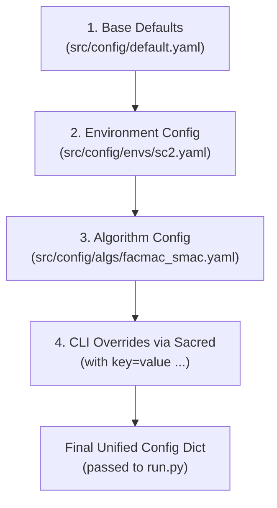

# 01 — Repository Structure, Startup, and Execution Entry Points

This document details the file organization of the RACE repository, traces execution from the shell command through Python entry points, explains configuration layering and Sacred experiment management, and documents process startup.

---

## 1. Repository Layout

The RACE repository is organized into shell wrappers, configuration files, neural network modules, evolutionary algorithms, and environment interfaces:

```text
RACE/
├── .env                              # Environment variables (private: contains StarCraft II / SMAC paths)
├── .gitignore                        # Git exclusion rules
├── .python-version                   # Pyenv configuration pin (3.6.15)
├── README.md                         # Author documentation & baseline instructions
├── requirements.txt                  # Python dependencies
├── run.sh                            # Author reference nohup execution script
├── run_race_feasibility.sh           # User-created test script verifying reproducibility
├── install_sc2.sh                    # Blizzard StarCraft II Linux client installer
├── Race.pdf                          # ICML 2023 published paper
├── figure/                           # Architecture diagrams from the paper
├── feasibility_results/              # Timestamped test artifacts (e.g., 20261027_165005/)
├── results/                          # Sacred experiment records (results/sacred/)
├── src/                              # Main Python package
│   ├── main.py                       # CLI entry point, configuration parsing, Sacred setup
│   ├── run.py                        # Execution orchestrator: runner, buffer, controller, learner loop
│   ├── config/                       # YAML configuration hierarchies
│   │   ├── default.yaml              # Global default hyperparameters
│   │   ├── algs/                     # Algorithm-specific configurations (e.g., facmac_smac.yaml)
│   │   └── envs/                     # Environment configurations (e.g., sc2.yaml, mujoco_multi.yaml)
│   ├── components/                   # Buffers, transforms, epsilon schedules, action selectors
│   │   ├── episode_buffer.py         # ReplayBuffer & EpisodeBatch tensor storage
│   │   ├── action_selectors.py       # GumbelSoftmax, EpsilonGreedy, Multinomial action selectors
│   │   └── transforms.py             # OneHot encoding transforms
│   ├── controllers/                  # Multi-Agent Controllers (MAC)
│   │   ├── basic_controller.py       # Standard PyMARL BasicMAC
│   │   └── EA_basic_controller.py    # RL_BasicMAC (MARL team) & Gen_BasicMAC (EA population)
│   ├── ea/                           # Neuro-Evolutionary operators
│   │   ├── mod_neuro_evo.py          # Active Steady-State Neuro-Evolution (SSNE) engine
│   │   ├── mod_neuro_evo_abl_*.py    # Ablation variants (crossover ablation, mutation ablation)
│   │   └── mod_utils.py              # Priority queues, sum-trees, normalization helpers
│   ├── envs/                         # Environment wrappers
│   │   ├── __init__.py               # Environment registry (SC2, Particle, MuJoCo)
│   │   └── mamujoco/                 # Multi-Agent MuJoCo environment source
│   ├── learners/                     # Training algorithms
│   │   ├── facmac_learner_discrete.py      # Standard FACMAC discrete learner
│   │   └── EA_facmac_learner_discrete.py   # RACE learner (PeVFA, V_Net, MINE, VFM, VMM)
│   ├── modules/                      # PyTorch neural network modules
│   │   ├── agents/                   # Agent sub-networks (EA_qmix_agent.py: SR encoder and W head)
│   │   ├── critics/                  # Centralized critics (facmac.py: PeVFA_FACMACDiscreteCritic)
│   │   └── mixers/                   # Value mixing nets (qmix.py: QMixer, PeVFA_QMixer, V_Net)
│   ├── runners/                      # Environment interaction drivers
│   │   ├── episode_runner.py         # EpisodeRunner (single-environment episodic execution)
│   │   └── parallel_runner.py        # ParallelRunner (vectorized multi-env execution)
│   └── utils/                        # Logging, math, and time helpers
│       ├── logging.py                # Console and Sacred logger
│       └── rl_utils.py               # TD-lambda target computations
└── venv/                             # Virtualenv containing Python 3.6, PyTorch 1.9, PySC2, etc.
```

---

## 2. Command-Line Entry Point & Feasibility Execution

The user's minimal reproducibility test command, defined in [`run_race_feasibility.sh:181-196`](file:///home/tharuka/Documents/GitHub/RACE/run_race_feasibility.sh#L181-L196), is:

```bash
python3 src/main.py \
  --config=facmac_smac \
  --env-config=sc2 \
  with \
  env_args.map_name=3s_vs_3z \
  batch_size_run=1 \
  state_alpha=0.001 \
  frac=0.005 \
  EA_alpha=1.0 \
  Org_alpha=1.0 \
  EA=1 \
  EA_freq=1 \
  SAME=0 \
  use_cuda=False \
  t_max=10000
```

### Static Breakdown of Arguments
1. `--config=facmac_smac`: Selects [`src/config/algs/facmac_smac.yaml`](file:///home/tharuka/Documents/GitHub/RACE/src/config/algs/facmac_smac.yaml), which configures FACMAC as the base MARL algorithm, using Gumbel-Softmax discrete exploration, Adam optimizers, and QMIX mixing networks.
2. `--env-config=sc2`: Selects [`src/config/envs/sc2.yaml`](file:///home/tharuka/Documents/GitHub/RACE/src/config/envs/sc2.yaml), setting up the StarCraft Multi-Agent Challenge (SMAC) wrapper.
3. `with`: Sacred keyword designating that following key-value pairs are configuration overrides.
4. `env_args.map_name=3s_vs_3z`: Overrides the default map (`3m`) to the 3 Stalkers vs 3 Zealots scenario.
5. `batch_size_run=1`: Runs 1 environment instance in serial mode.
6. `state_alpha=0.001`: Sets $\beta = 10^{-3}$, the weight balancing Value-Aware Mutual Information (VMM) in the shared encoder loss (Paper Eq. 6 & Table 4).
7. `frac=0.005`: Sets $\alpha = 0.005$, the fraction parameter for evolutionary mutation (Paper Table 4).
8. `EA_alpha=1.0`: Coefficient weighting the evolutionary team PeVFA gradient in Value Function Maximization (Paper Eq. 2).
9. `Org_alpha=1.0`: Coefficient weighting the MARL team policy gradient in Value Function Maximization (Paper Eq. 2).
10. `EA=1`: Enables the RACE evolutionary framework (populating `pop`, PeVFA, V_Net, and MINE).
11. `EA_freq=1`: Evaluates and evolves the EA population every episode (after warmup).
12. `SAME=0`: Constructs independent linear policy representations $W_j^i$ for each agent within each EA team (rather than sharing one $W$ across all agents).
13. `use_cuda=False`: Executes exclusively on the CPU.
14. `t_max=10000`: Sets the total environment timestep training budget to 10,000 steps.

---

## 3. Configuration Loading Hierarchy and Precedence

The configuration loading logic in [`src/main.py:82-107`](file:///home/tharuka/Documents/GitHub/RACE/src/main.py#L82-L107) follows a strict four-layer precedence model:



### Loading Mechanics
1. **Base Defaults (`src/config/default.yaml`):**  
   Loaded first via PyYAML ([`src/main.py:86-90`](file:///home/tharuka/Documents/GitHub/RACE/src/main.py#L86-L90)). Contains default parameters for PyMARL, EA settings (`pop_size: 5`, `frac: 1.0`, `EA_alpha: 1.0`), buffer settings, and scheduling.
2. **Environment Configuration (`src/config/envs/sc2.yaml`):**  
   Intercepted by `_get_config(params, "--env-config", "envs")` ([`src/main.py:47-62`](file:///home/tharuka/Documents/GitHub/RACE/src/main.py#L47-L62)). Keys are recursively merged into the dictionary via `recursive_dict_update()` ([`src/main.py:64-70, 96`](file:///home/tharuka/Documents/GitHub/RACE/src/main.py#L64-L70)).
3. **Algorithm Configuration (`src/config/algs/facmac_smac.yaml`):**  
   Intercepted by `_get_config(params, "--config", "algs")` ([`src/main.py:94`](file:///home/tharuka/Documents/GitHub/RACE/src/main.py#L94)). Its keys override any overlapping defaults from layers 1 and 2 (e.g., `mac: basic_mac`, `mixer: qmix`, `learner: facmac_learner_discrete`).
4. **Command-Line Overrides (`with ...`):**  
   Passed directly to `ex.run_commandline(params)` ([`src/main.py:107`](file:///home/tharuka/Documents/GitHub/RACE/src/main.py#L107)). Sacred parses these arguments, giving them the highest precedence over all YAML files.

---

## 4. Process Initialization & Thread Control

Before any neural networks are created, [`src/main.py:16-23`](file:///home/tharuka/Documents/GitHub/RACE/src/main.py#L16-L23) enforces strict single-threaded CPU execution:

```python
cpu_num = 1
os.environ ['OMP_NUM_THREADS'] = str(cpu_num)
os.environ ['OPENBLAS_NUM_THREADS'] = str(cpu_num)
os.environ ['MKL_NUM_THREADS'] = str(cpu_num)
os.environ ['VECLIB_MAXIMUM_THREADS'] = str(cpu_num)
os.environ ['NUMEXPR_NUM_THREADS'] = str(cpu_num)
th.set_num_threads(cpu_num)
```

This prevents OpenMP, MKL, and BLAS libraries from spawning thread pools that compete for cores during serial rollouts.

### Experiment Observers & Logging Setup
* **Sacred Experiment Observer:**  
  [`src/main.py:103-105`](file:///home/tharuka/Documents/GitHub/RACE/src/main.py#L103-L105) adds a `FileStorageObserver` targeting `results/sacred`. Every execution creates a numeric directory (e.g., `results/sacred/6/`) storing:
  - `config.json`: The exact merged configuration dictionary.
  - `run.json`: Host hardware information, timestamps, git commits, and status.
  - `cout.txt`: Captured stdout/stderr streams (`CAPTURE_MODE="fd"`).
  - `info.json`: Time-series logging of episodic metrics, win rates, and losses.
* **WandB Initialization:**  
  [`src/run.py:91-93`](file:///home/tharuka/Documents/GitHub/RACE/src/run.py#L91-L93) sets `os.environ["WANDB_MODE"] = "disabled"`, suppressing network transmissions to Weights & Biases unless explicitly enabled.

---

## 5. Reaching the Training Loop

When Sacred executes `ex.run_commandline(params)`:
1. Sacred invokes `@ex.main` function `my_main(_run, _config, _log)` ([`src/main.py:35-44`](file:///home/tharuka/Documents/GitHub/RACE/src/main.py#L35-L44)).
2. Seeds are applied to NumPy, PyTorch, and the environment config ([`src/main.py:39-41`](file:///home/tharuka/Documents/GitHub/RACE/src/main.py#L39-L41)).
3. `my_main` calls `run(_run, config, _log)` in [`src/run.py:28`](file:///home/tharuka/Documents/GitHub/RACE/src/run.py#L28).
4. `run()` performs argument sanity checks (`args_sanity_check`, lines 460–474) and calls `run_sequential(args, logger)` ([`src/run.py:95`](file:///home/tharuka/Documents/GitHub/RACE/src/run.py#L95)).
5. `run_sequential` instantiates:
   - `runner = EpisodeRunner(args, logger)` ([`src/run.py:103`](file:///home/tharuka/Documents/GitHub/RACE/src/run.py#L103))
   - `buffer = ReplayBuffer(...)` ([`src/run.py:214`](file:///home/tharuka/Documents/GitHub/RACE/src/run.py#L214))
   - `evolver = SSNE(args)` ([`src/ea/mod_neuro_evo.py:7`](file:///home/tharuka/Documents/GitHub/RACE/src/ea/mod_neuro_evo.py#L7), [`src/run.py:217`](file:///home/tharuka/Documents/GitHub/RACE/src/run.py#L217))
   - `mac = RL_BasicMAC(...)` ([`src/controllers/EA_basic_controller.py:7`](file:///home/tharuka/Documents/GitHub/RACE/src/controllers/EA_basic_controller.py#L7), [`src/run.py:221`](file:///home/tharuka/Documents/GitHub/RACE/src/run.py#L221))
   - `pop = [Gen_BasicMAC(..., mac.agent_SR, ...) for _ in range(5)]` ([`src/run.py:222-223`](file:///home/tharuka/Documents/GitHub/RACE/src/run.py#L222-L223))
   - `learner = EA_FACMACDiscreteLearner(mac, ...)` ([`src/learners/EA_facmac_learner_discrete.py:132`](file:///home/tharuka/Documents/GitHub/RACE/src/learners/EA_facmac_learner_discrete.py#L132), [`src/run.py:233`](file:///home/tharuka/Documents/GitHub/RACE/src/run.py#L233))
6. Execution enters the main while loop: `while runner.t_env <= args.t_max:` ([`src/run.py:284`](file:///home/tharuka/Documents/GitHub/RACE/src/run.py#L284)).

---

## 6. Local Modifications & Security Context

1. **Environment Setup & `.env`:**  
   The workspace uses a local `.env` file to set `SC2PATH` and `PYTHONPATH`. In compliance with safety rules, `.env` is confirmed to exist for locating the StarCraft II engine, but its private values and directory paths are strictly protected and omitted from documentation.
2. **Feasibility Harness:**  
   The shell script [`run_race_feasibility.sh`](file:///home/tharuka/Documents/GitHub/RACE/run_race_feasibility.sh) was authored locally to automate smoke-testing of the environment and dependencies. It writes outputs into `feasibility_results/` and validates successful completion without modifying any source code.
