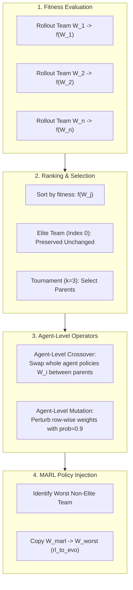

# 02 — The RACE Algorithm Explained

This document explains the mathematical foundations, system concepts, and architectural innovations of **RACE** (**Representation Asymmetry and Collaborative Evolution**), contrasting what the ICML 2023 paper describes with what the code actually does.

---

## 1. Problem Context: Why MARL Needs Evolution and Representation Asymmetry

In cooperative Multi-Agent Reinforcement Learning (MARL), multiple agents must learn coordinated behaviors in a shared environment (formalized as a Dec-POMDP). MARL approaches face two fundamental bottlenecks:
1. **Low-Quality, Delayed, or Non-Stationary Reward Signals:** Gradient-based policy optimization (e.g., policy gradients) struggles when rewards are sparse, deceptive, or non-stationary due to concurrent learning.
2. **Vast, Unstructured Policy Exploration Space:** Searching for coordinated multi-agent policies across millions of deep neural network parameters is inefficient.

Evolutionary Algorithms (EAs) optimize directly on episodic cumulative return (fitness) without relying on value function approximations or the Markov assumption, making them robust to sparse rewards. However, maintaining and mutating independent deep neural networks for dozens of agents is computationally prohibitive and discards shared representation knowledge.

**RACE resolves this tension through two core principles:**
* **Representation Asymmetry Team Construction (RATC):** Decouples policies into a deep, non-linear **Shared Observation Representation Encoder** ($Z_\phi$) shared across agents and teams, and compact **Linear Policy Representations** ($W$).
* **Collaborative Evolution & Shared Learning:** Uses EA to search the compact linear policy space using agent-level genetic operators, while MARL trains the shared representation using **Value Function Maximization (VFM)** and **Value-Aware Mutual Information Maximization (VMM)**.

---

## 2. Representation Asymmetry Team Construction (RATC)

### Concept & Paper Description (Section 3.1, Figure 1)
For $N$ agents controlled across $n$ evolutionary teams and 1 MARL team, the policy of team $j$ controlling agent $i$ is decomposed into:
$$\pi_j^i(o_t^i) = \text{act}\left( Z_{\phi_i}(o_t^i)^T W_{j,[1:d]}^i + W_{j,[d+1]}^i \right) \in \mathbb{R}^{|\mathcal{U}_i|}$$
Where:
* $Z_{\phi_i}(o_t^i) \in \mathbb{R}^d$ is the non-linear shared observation encoder (parameters $\phi$).
* $W_j^i \in \mathbb{R}^{(d+1) \times |\mathcal{U}_i|}$ is the linear policy representation for agent $i$ in team $j$.
* Team $j$ is represented as the set of policy representations: $W_j = \{W_j^1, W_j^2, \dots, W_j^N\}$.
* The population is $\mathcal{P} = \{W_1, W_2, \dots, W_n\}$.

### Implementation Details
* **Source Files:** [`src/controllers/EA_basic_controller.py:7-301`](file:///home/tharuka/Documents/GitHub/RACE/src/controllers/EA_basic_controller.py#L7-L301), [`src/modules/agents/EA_qmix_agent.py:27-68`](file:///home/tharuka/Documents/GitHub/RACE/src/modules/agents/EA_qmix_agent.py#L27-L68).
* **Classes:**
  - `QMIXRNNAgent_SR`: The shared representation network ($Z_\phi$). In discrete SMAC, it comprises a linear projection (`fc1`: `Linear(input_shape, 64)`) followed by a gated recurrent unit (`rnn`: `GRUCell(64, 64)`).
  - `QMIXRNNAgent_W`: The linear policy head ($W$). It comprises a single linear layer (`fc2`: `Linear(64, n_actions)`).
  - `RL_BasicMAC`: Controller for the MARL team ($W_{marl}$). Instantiates `self.agent_SR` and shares one `agent_W` head across all agents ([`lines 97-101`](file:///home/tharuka/Documents/GitHub/RACE/src/controllers/EA_basic_controller.py#L97-L101)).
  - `Gen_BasicMAC`: Controller for each EA team in $\mathcal{P}$. Injected with `mac.agent_SR` so that all EA teams share the exact same encoder instance as MARL ([`src/run.py:223`](file:///home/tharuka/Documents/GitHub/RACE/src/run.py#L223)).

### Audit & Comparison
* **Paper Says:** Shared encoder $Z_{\phi_i}$ can be agent-specific or shared. In Section A.1, the authors note that for SMAC, $Z_\phi$ is shared across all agents in the team to ensure fair comparison with standard FACMAC.
* **Code Does:** Directly confirmed. In [`src/run.py:221-223`](file:///home/tharuka/Documents/GitHub/RACE/src/run.py#L221-L223), `mac.agent_SR` is created once and passed into all five `Gen_BasicMAC` instances.
* **Discrepancy Uncovered:** In [`src/controllers/EA_basic_controller.py:193`](file:///home/tharuka/Documents/GitHub/RACE/src/controllers/EA_basic_controller.py#L193), when `SAME=0`, the forward loop indexes `self.agent_W[0]` instead of `self.agent_W[i]`. Thus, during action generation, agent 0's linear head is reused across all agents in that EA team.

---

## 3. Shared Observation Representation Learning

Because all candidate policies make decisions on top of $Z_\phi$, the representation space must contain rich information about both team coordination and the global environment. RACE optimizes $Z_\phi$ using two complementary loss functions:

### 3.1. Value Function Maximization (VFM)

#### Purpose (Paper Section 3.2, Eq. 2)
Adjusts $Z_\phi$ so that the induced linear policy space maximizes expected cumulative return across both the MARL team and evolutionary teams:
$$\mathcal{L}^{VFM}_{\phi_i} = - \mathbb{E}_{\mathcal{D}, \mathcal{P}} \left[ Q_\psi(s, \pi_{marl}(s)) + Q_\theta(s, \pi_j(s), W_j) \right]$$

#### Networks & Roles
1. **Conventional MARL Critic ($Q_\psi$):**  
   Evaluates MARL policy actions. Implemented in [`src/modules/critics/facmac.py:38-68`](file:///home/tharuka/Documents/GitHub/RACE/src/modules/critics/facmac.py#L38-L68) (`FACMACDiscreteCritic`) paired with [`src/modules/mixers/qmix.py:31-103`](file:///home/tharuka/Documents/GitHub/RACE/src/modules/mixers/qmix.py#L31-L103) (`QMixer`).
2. **Policy-Extended Value Function Approximator (PeVFA, $Q_\theta$):**  
   Evaluates EA candidate team policies $W_j \sim \mathcal{P}$. Implemented in [`src/modules/critics/facmac.py:71-126`](file:///home/tharuka/Documents/GitHub/RACE/src/modules/critics/facmac.py#L71-L126) (`PeVFA_FACMACDiscreteCritic`) and [`src/modules/mixers/qmix.py:106-207`](file:///home/tharuka/Documents/GitHub/RACE/src/modules/mixers/qmix.py#L106-L207) (`PeVFA_QMixer`).  
   - Policy parameters $W_j$ are converted to a flat vector, passed through a 3-layer MLP (`layer_p1`, `p2`, `p3` of dimension 64), and averaged across actions to create a 64-dimensional policy embedding $e_{W_j}$.
   - $e_{W_j}$ is concatenated with agent observations and actions in the local critics, and concatenated with the global state in the mixer hypernetwork.
3. **Loss Computation in Code:**  
   In [`src/learners/EA_facmac_learner_discrete.py:361, 419, 425`](file:///home/tharuka/Documents/GitHub/RACE/src/learners/EA_facmac_learner_discrete.py#L361):
   - `pg_loss = - (chosen_action_qvals * mask).sum() / mask.sum()` (MARL critic gradient)
   - `ea_pg_loss = - self.args.EA_alpha * (ea_chosen_action_qvals * mask).sum() / mask.sum() + self.args.state_alpha * MINE_loss`
   - `total_loss = self.args.Org_alpha * pg_loss + ea_pg_loss`

### 3.2. Value-Aware Mutual Information Maximization (VMM)

#### Purpose (Paper Section 3.2, Eq. 3–5)
Under partial observability, local observation $o^i$ lacks global state information, leading to severe non-stationarity. RACE maximizes mutual information $I(Z_\phi(o^i); s)$ between representations and the global state $s$. To prevent learning representations from low-reward, uncoordinated states, mutual information is weighted by normalized state values:
$$\mathcal{L}^{VMM}_{\phi_i} = - \mathbb{E}_{\mathcal{D}} \left[ \frac{V_\zeta(s_t) - \min_{s_j} V_\zeta(s_j)}{\max_{s_j} V_\zeta(s_j) - \min_{s_j} V_\zeta(s_j)} \mathcal{I}_t(z_t^i, s_t) \right]$$

#### Networks & Execution
1. **MINE Network ($T_\omega$):**  
   Implemented in [`src/learners/EA_facmac_learner_discrete.py:110-129`](file:///home/tharuka/Documents/GitHub/RACE/src/learners/EA_facmac_learner_discrete.py#L110-L129). Takes representation $Z$ (dim 64) through 2 linear layers (128 units, leaky ReLU) and global state $s$ through 1 linear layer (128 units), computing the Jensen-Shannon lower bound via Fenchel dual loss (`fenchel_dual_loss`, lines 79–107).
2. **State-Value Network ($V_\zeta$):**  
   Implemented in [`src/modules/mixers/qmix.py:6-28`](file:///home/tharuka/Documents/GitHub/RACE/src/modules/mixers/qmix.py#L6-L28) (`V_Net`). A 2-hidden-layer MLP (hidden dimension 32, ReLU) trained to estimate $F(s) = r + \max(Q_{\psi'}, Q_{\theta'})$:
   ```python
   # EA_facmac_learner_discrete.py:327-330
   V_pre = self.V_Net(batch["state"][:, :-1])
   V_error = (V_pre - torch.max(targets_1.detach(), targets.detach()))
   V_loss = (masked_v_error ** 2).sum() / mask.sum()
   ```
3. **Weighting Application:**  
   In [`src/learners/EA_facmac_learner_discrete.py:368-399`](file:///home/tharuka/Documents/GitHub/RACE/src/learners/EA_facmac_learner_discrete.py#L368-L399), predictions $V_{pre}$ are min-max normalized across the sampled batch into weights $\in [0, 1]$ and multiplied by per-step MINE loss:
   `MINE_loss += (weight * mi_loss).mean()`

### 3.3. Combined Representation Objective
In [`src/learners/EA_facmac_learner_discrete.py:419-434`](file:///home/tharuka/Documents/GitHub/RACE/src/learners/EA_facmac_learner_discrete.py#L419-L434), total loss combines VFM and VMM:
$$\mathcal{L}_\phi = \text{Org\_alpha} \cdot \mathcal{L}_{MARL} + \text{EA\_alpha} \cdot \mathcal{L}_{EA} + \text{state\_alpha} \cdot \mathcal{L}_{MINE}$$
A single backward pass propagates gradients through `total_loss`, updating encoder $Z_\phi$ and MARL heads via `agent_optimiser`, and updating MINE via `MINE_optimiser`.

---

## 4. Collaborative Evolution in Linear Policy Space

Instead of mutating full neural networks, evolutionary operators operate exclusively on the linear policy matrices $W_j^i$.



### 4.1. Agent-Level Crossover (Team Composition Search)
* **Paper Formulation (Section 3.3):**  
  Selects two teams $W_i, W_j$. A subset of agent indices $d$ is sampled, and corresponding policy matrices are swapped:
  $$W_i', W_j' = ((W_i - W_i^d) \cup W_j^d, (W_j - W_j^d) \cup W_i^d)$$
* **Code Implementation:**  
  In [`src/ea/mod_neuro_evo.py:185-189`](file:///home/tharuka/Documents/GitHub/RACE/src/ea/mod_neuro_evo.py#L185-L189), when `agent_level=True`:
  ```python
  if random.random() < 0.5:
      self.clone(master=pop[i], replacee=pop[j], agent_index=agent_index)
  else:
      self.clone(master=pop[j], replacee=pop[i], agent_index=agent_index)
  ```
  For each agent index, the entire parameter tensor `agent_W[agent_index]` is copied between candidate teams.

### 4.2. Agent-Level Mutation (Individual Policy Search)
* **Paper Formulation (Section 3.3):**  
  Perturbs parameters of selected agent policies by adding Gaussian noise or resetting weights.
* **Code Implementation:**  
  In [`src/ea/mod_neuro_evo.py:79-129`](file:///home/tharuka/Documents/GitHub/RACE/src/ea/mod_neuro_evo.py#L79-L129):
  For each action row in linear policy matrix $W$:
  - A subset of incoming representation weights is sampled:
    `index_list = random.sample(range(W.shape[1]), int(W.shape[1] * self.frac))`
  - Parameters are perturbed:
    * With prob `super_mut_prob` (0.05): $W[idx] += \mathcal{N}(0, 10 \cdot W[idx])$
    * With prob `reset_prob` (0.05): $W[idx] = \mathcal{N}(0, 1)$
    * Otherwise: $W[idx] += \mathcal{N}(0, 0.1 \cdot W[idx])$

### 4.3. MARL-to-EA Policy Injection
* **Paper Formulation (Section 3.3):**  
  MARL team policy $W_{marl}$ is injected periodically into the population to guide evolution.
* **Code Implementation:**  
  In [`src/run.py:426-435`](file:///home/tharuka/Documents/GitHub/RACE/src/run.py#L426-L435):
  ```python
  if args.EA and runner.t_env > args.start_timesteps and episode % args.EA_freq == 0:
      replace_index = np.argmin(fitness)
      if replace_index == elite_index:
          replace_index = (replace_index + 1) % args.pop_size
      for index in range(args.n_agents):
          rl_to_evo(mac, pop[replace_index], index)
  ```
  The worst-performing team in $\mathcal{P}$ is replaced by copying the weights of `mac.agent_W` directly into `pop[replace_index].agent_W`.

---

## 5. Summary Comparison: Paper vs. Code

| Feature / Mechanism | Paper Description | Verified Source Code Implementation | Status |
|:---|:---|:---|:---:|
| **Representation Decomposition** | Shared encoder $Z_\phi$ + linear policy $W_j^i$ | `QMIXRNNAgent_SR` (GRU) + `QMIXRNNAgent_W` (Linear) | **Verified** |
| **PeVFA Input Construction** | Policy parameter vector embedded via MLP | 3-layer MLP (`layer_p1`, `p2`, `p3`), units 64, leaky ReLU | **Verified** |
| **VFM Loss Formulation** | Joint maximization of $Q_\psi$ and $Q_\theta$ | `- (Org_alpha * pg_loss + EA_alpha * ea_pg_loss)` | **Verified** |
| **VMM Weighting** | Normalized state values $V(s)$ | Min-max normalized $V_{pre}$ from `V_Net` | **Verified** |
| **Evolution Timing** | Interleaved every iteration | Gated by `runner.t_env > 10000` (`start_timesteps`) | **Discrepancy** |
| **Agent Representation Forward** | Distinct policy $W_j^i$ for agent $i$ | Line 193 reuses `agent_W[0]` for all agents when `SAME=0` | **Discrepancy** |
| **Mutation Parameter `frac`** | Fraction $\alpha$ of mutated parameters | `int(W.shape[1] * frac)` truncates to 0 for `frac=0.005` in discrete SMAC | **Discrepancy** |
