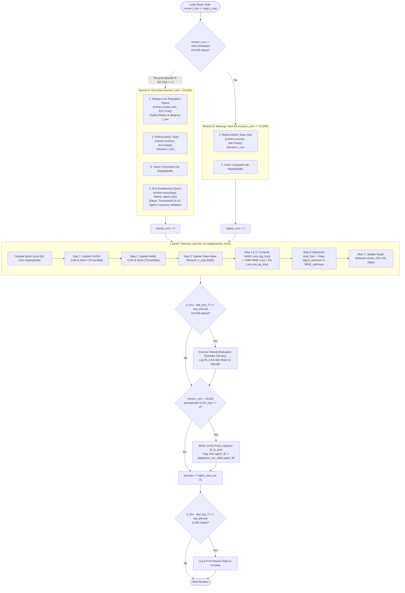

# 04 — Step-by-Step Training Iteration

This document traces the exact chronological execution of a single training iteration in the RACE codebase. It highlights the sequence of operations, environment step progressions, update frequencies, and compares the codebase timeline with Algorithm 1 from the paper.

---

## 1. Timeline of One Training Iteration

A training iteration in RACE is governed by the while-loop in [`src/run.py:284-456`](file:///home/tharuka/Documents/GitHub/RACE/src/run.py#L284-L456): `while runner.t_env <= args.t_max:`. Each pass through this loop corresponds to one episodic generation.



---

## 2. Chronological Phase-by-Phase Breakdown

### Phase 1: Environment Rollout
* **Condition:** Evaluated at [`src/run.py:289`](file:///home/tharuka/Documents/GitHub/RACE/src/run.py#L289):
  `if args.EA and runner.t_env > args.start_timesteps and episode % args.EA_freq == 0:`
* **When True (Post-Warmup EA Active):**
  1. The 5 candidate teams in `pop` are rolled out sequentially:
     [`src/run.py:291-295`](file:///home/tharuka/Documents/GitHub/RACE/src/run.py#L291-L295):
     ```python
     for ea_mac in pop:
         episode_batch, episode_return, _ = runner.run(ea_mac, test_mode=False, EA=True, learner=learner)
         fitness.append(episode_return)
         buffer.insert_episode_batch(episode_batch)
     ```
     - In [`src/runners/episode_runner.py:75-78`](file:///home/tharuka/Documents/GitHub/RACE/src/runners/episode_runner.py#L75-L78), because `EA=True`, `explore=False`: EA teams do not use Gumbel exploration noise.
     - Each rollout advances `runner.t_env` by the episode length ($T \approx 50\text{--}60$ steps). Across 5 EA teams, `t_env` increases by $\approx 250\text{--}300$ steps.
  2. The MARL team (`mac`) is rolled out:
     [`src/run.py:297-299`](file:///home/tharuka/Documents/GitHub/RACE/src/run.py#L297-L299):
     - `runner.run(mac, EA=False, test_mode=False)`: Uses active exploration noise (`explore=True`).
     - Adds its episode to the shared buffer and advances `t_env` by another $T$ steps.
* **When False (During Warmup, $t_{env} \le 10,000$):**
  - Only `mac` is rolled out ([`src/run.py:310-314`](file:///home/tharuka/Documents/GitHub/RACE/src/run.py#L310-L314)). `fitness = [0, 0, 0, 0, 0]`. `t_env` advances by 1 episode length.

### Phase 2: Evolutionary Operators in Linear Policy Space
* **Execution:** Only executes when EA is active ([`src/run.py:303-309`](file:///home/tharuka/Documents/GitHub/RACE/src/run.py#L303-L309)).
* **Loop Over Agents:**
  ```python
  for agent_index in range(args.n_agents):
      elite_index = evolver.epoch(pop, fitness, agent_index, agent_level=True)
  ```
* **Step Details inside `SSNE.epoch` ([`src/ea/mod_neuro_evo.py:143-207`](file:///home/tharuka/Documents/GitHub/RACE/src/ea/mod_neuro_evo.py#L143-L207)):
  1. **Elite Selection:** Candidate teams are sorted by fitness. The highest-scoring team (`index_rank[0]`) is designated elite (`num_elitists = 1`).
  2. **Tournament Selection:** For non-elite slots, 3 candidate teams are sampled randomly, and the one with highest fitness wins (`tournament_size = 3`).
  3. **Preservation:** The elite team's policy for `agent_index` is cloned into an unselected team slot via `self.clone()`.
  4. **Agent-Level Crossover:** Pairs of unselected candidate teams swap entire linear policy representations $W^i$ with probability 1.0 (lines 185–189).
  5. **Agent-Level Mutation:** For every non-elite team, with probability `mutation_prob` (0.9), `self.mutate_inplace(pop[i], agent_index, agent_level=True)` perturbs row-wise weights using `frac`.

### Phase 3: Off-Policy Training of Networks
* **Batch Repeat Multiplier:**
  - If EA was active in this episode: `repeat_num = 6` ([`src/run.py:316`](file:///home/tharuka/Documents/GitHub/RACE/src/run.py#L316)).
  - If during warmup: `repeat_num = 1` ([`src/run.py:318`](file:///home/tharuka/Documents/GitHub/RACE/src/run.py#L318)).
* **Execution Loop ([`src/run.py:322-343`](file:///home/tharuka/Documents/GitHub/RACE/src/run.py#L322-L343)):**
  For each iteration in `range(repeat_num)`:
  1. A batch of 32 episodes is sampled uniformly from `buffer`: `episode_sample = buffer.sample(32)`.
  2. `all_teams = pop + [mac]` is assembled (contains 6 teams).
  3. `learner.train(episode_sample, all_teams, runner.t_env, episode)` is executed.

#### Internal Sub-Steps of `EA_FACMACDiscreteLearner.train` ([`src/learners/EA_facmac_learner_discrete.py:209-456`](file:///home/tharuka/Documents/GitHub/RACE/src/learners/EA_facmac_learner_discrete.py#L209-L456)):
1. **PeVFA Critic & Mixer TD Update (lines 221–276):**
   - Randomly samples 1 team from `all_teams`.
   - Extracts flat parameter vector of linear heads: `param_list`.
   - Passes $(o, u, W_j)$ to `PeVFA_critic` and mixes with `PeVFA_mixer`.
   - Computes TD($\lambda$) targets: `targets`.
   - Loss: `ea_loss = (masked_td_error ** 2).sum() / mask.sum()`.
   - Backward pass on `ea_loss`, clips gradient to 10, steps `self.PeVFA_optimiser` (Adam, lr=0.0005).
2. **MARL Critic & Mixer TD Update (lines 280–322):**
   - Evaluates actions of `target_mac`.
   - Passes $(o, u)$ to `self.critic` and mixes with `self.mixer`.
   - Computes TD($\lambda$) targets: `targets_1`.
   - Loss: `loss = (masked_td_error ** 2).sum() / mask.sum()`.
   - Backward pass on `loss`, clips gradient to 10, steps `self.critic_optimiser` (Adam, lr=0.0005).
3. **State-Value Network $V_\zeta$ Update (lines 327–335):**
   - Target is the pointwise maximum: `torch.max(targets_1.detach(), targets.detach())` ($F(s)$ from Paper Eq. 4).
   - Loss: `V_loss = ((V_pre - max_targets) ** 2 * mask).sum() / mask.sum()`.
   - Backward pass on `V_loss`, clips gradient, steps `self.V_Net_optimiser` (Adam, lr=0.0005).
4. **MARL Policy Loss (lines 343–362):**
   - Evaluates current MARL actions through `self.critic` and `self.mixer`.
   - Policy gradient loss: `pg_loss = - (chosen_action_qvals * mask).sum() / mask.sum()`.
5. **Value-Aware MINE Loss & EA Policy Loss (lines 366–420):**
   - Computes min-max normalized state value weights from $V_\zeta$: `weight = V_weight[:, t]`.
   - Samples 1 team from `all_teams`, extracts representation $Z$, computes MINE loss against global state $s$:
     `mi_loss, _ = self.MINE.forward(reshape_Z, repeat_state)`.
     `MINE_loss += (weight * mi_loss).mean()`.
   - Evaluates sampled team actions through `PeVFA_critic` and `PeVFA_mixer`:
     `ea_pg_loss = - self.args.EA_alpha * (ea_qvals * mask).sum() / mask.sum() + self.args.state_alpha * MINE_loss`.
6. **Joint Representation and Policy Backward Pass (lines 425–434):**
   - Total loss: `total_loss = self.args.Org_alpha * pg_loss + ea_pg_loss`.
   - Zero gradients: `MINE_optimiser.zero_grad()`, `agent_optimiser.zero_grad()`.
   - `total_loss.backward()`: Propagates gradients into:
     * `self.mac.agent_SR` (the shared encoder $Z_\phi$) from both MARL critic, PeVFA critic, and MINE.
     * `self.mac.agent_W` (the MARL policy heads) from the MARL critic.
     * `self.MINE` parameters from MINE loss.
   - Clips gradients to 10.
   - Steps `self.agent_optimiser` (Adam, lr=0.0025) and `self.MINE_optimiser` (Adam, lr=0.0005).
7. **Target Network Updates (lines 438–446):**
   - Every `target_update_interval = 200` critic steps: performs a hard state-dict copy into `target_PeVFA_critic`, `target_PeVFA_mixer`, `target_mac`, `target_critic`, and `target_mixer`.

### Phase 4: MARL-to-EA Policy Injection
* **Condition:** Post-warmup EA active:
  [`src/run.py:426-435`](file:///home/tharuka/Documents/GitHub/RACE/src/run.py#L426-L435):
* **Execution:**
  - Finds the worst-performing candidate team: `replace_index = np.argmin(fitness)`.
  - If `replace_index == elite_index`, shifts to `(replace_index + 1) % args.pop_size`.
  - For each agent, executes `rl_to_evo(mac, pop[replace_index], index)`:
    Copies `target_param.data.copy_(param.data)` from `mac.agent_W[index]` to `pop[replace_index].agent_W[index]`.

### Phase 5: Periodic Evaluation, Logging, and Episode Step
1. **Periodic Test Evaluation ([`src/run.py:367-425`](file:///home/tharuka/Documents/GitHub/RACE/src/run.py#L367-L425)):**
   - Triggered when `(runner.t_env - last_test_T) >= args.test_interval` (10,000 steps).
   - Runs 32 greedy evaluation episodes (`test_mode=True`) with MARL policy (`mac`) and 32 episodes with the best EA policy (`pop[argmax(fitness)]`).
   - Logs `Test_RL_won_rate`, `Test_EA_won_rate`, `Test_best_reward` to WandB and console.
2. **Episode Counter Increment ([`src/run.py:449`](file:///home/tharuka/Documents/GitHub/RACE/src/run.py#L449)):**
   - `episode += args.batch_size_run` (increments by 1).
3. **Training Telemetry Output ([`src/run.py:451-454`](file:///home/tharuka/Documents/GitHub/RACE/src/run.py#L451-L454)):**
   - Triggered when `(runner.t_env - last_log_T) >= args.log_interval` (2,000 steps).
   - Prints `Recent Stats | t_env: ... | Episode: ...` table to console and syncs with Sacred `info.json`.

---

## 3. Comparison with Paper Algorithm 1

| Algorithm Step | Paper Algorithm 1 Stated Sequence | Code Observed Execution Sequence | Exact Code Reference |
|:---|:---|:---|:---|
| **Population Rollout** | Line 4: Rollout each team in $\mathcal{P}$ for 1 episode | Executed first in iteration, **but only after step 10,000** | [`src/run.py:289-295`](file:///home/tharuka/Documents/GitHub/RACE/src/run.py#L289-L295) |
| **MARL Rollout** | Line 5: Rollout MARL team for 1 episode | Executed after population rollout | [`src/run.py:297-299`](file:///home/tharuka/Documents/GitHub/RACE/src/run.py#L297-L299) |
| **Replay Storage** | Line 6: Store experiences from $\mathcal{P}$ and $W_{marl}$ to $\mathcal{D}$ | Episodes inserted into `buffer` immediately upon completion | [`src/run.py:295, 299`](file:///home/tharuka/Documents/GitHub/RACE/src/run.py#L295) |
| **Genetic Operators** | Line 9: Perform selection, crossover, and mutation | Executed **before** learner training steps | [`src/run.py:306-308`](file:///home/tharuka/Documents/GitHub/RACE/src/run.py#L306-L308) |
| **Critic & Mixer Updates** | Line 8: Train $Q_\theta, Q_\psi, V_\zeta$ with $\mathcal{D}$ | Executed inside `learner.train()` (repeated 6 times if EA active) | [`src/learners/EA_facmac_learner_discrete.py:221-335`](file:///home/tharuka/Documents/GitHub/RACE/src/learners/EA_facmac_learner_discrete.py#L221-L335) |
| **MARL Policy Update** | Line 10: Optimize MARL policy $W_{marl}$ | Optimized jointly with shared encoder in one backward pass | [`src/learners/EA_facmac_learner_discrete.py:361, 425-434`](file:///home/tharuka/Documents/GitHub/RACE/src/learners/EA_facmac_learner_discrete.py#L361) |
| **Policy Injection** | Line 11: Inject MARL team policy to population $\mathcal{P}$ | Executed at the **end** of the episode loop | [`src/run.py:426-435`](file:///home/tharuka/Documents/GitHub/RACE/src/run.py#L426-L435) |
| **Shared Encoder Update** | Line 13: Update shared encoder $Z_\phi$ with VFM and VMM | Integrated directly into `learner.train()` Step 6 | [`src/learners/EA_facmac_learner_discrete.py:425-434`](file:///home/tharuka/Documents/GitHub/RACE/src/learners/EA_facmac_learner_discrete.py#L425-L434) |
