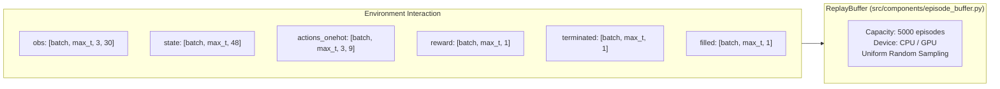
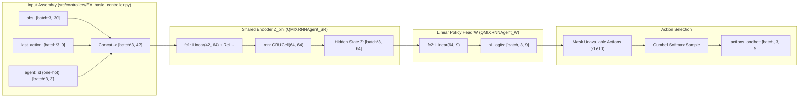
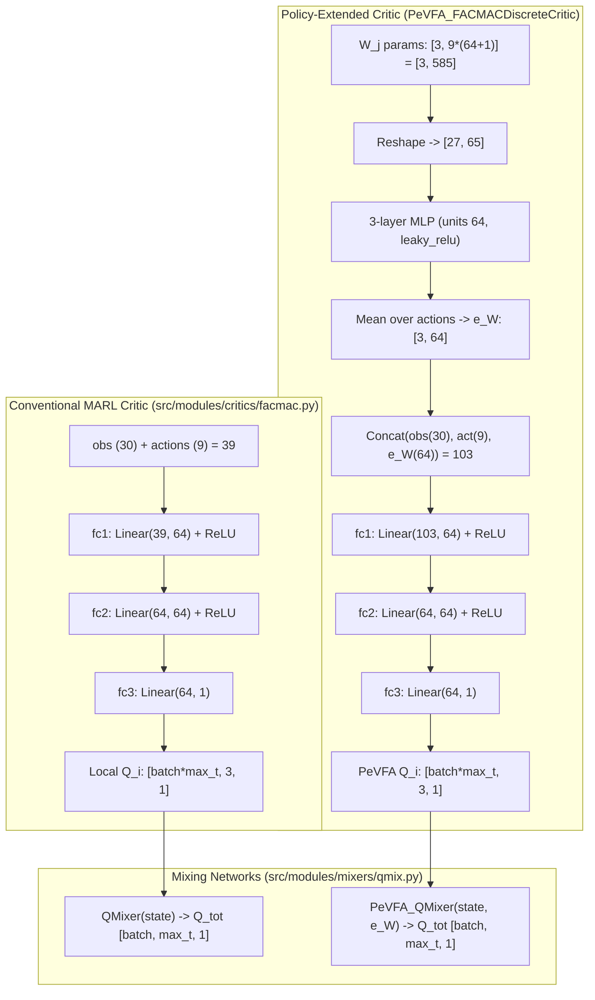
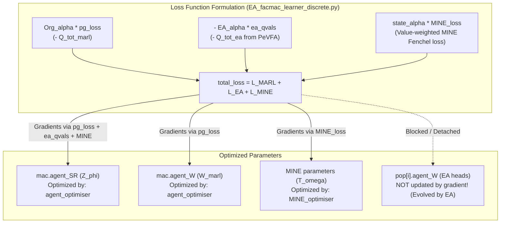

# 06 — Data Structures, Network Topologies, and Gradient Flow

This document details the tensors, data structures, neural network layers, input/output shapes, and backpropagation pathways across the RACE system, grounded in the discrete StarCraft Multi-Agent Challenge (`3s_vs_3z`).

---

## 1. Environment and Episodic Data Tensors

In SMAC scenario `3s_vs_3z`, there are:
* Number of agents: $N = 3$ (3 Protoss Stalkers).
* Number of actions per agent: $|\mathcal{U}| = 9$ (0: no-op, 1: stop, 2–5: move north/south/east/west, 6–8: attack enemy 0, 1, 2).
* Observation dimension: $|o^i| = 30$ (unit health, shield, cooldown, relative x/y of allies and enemies).
* Global state dimension: $|s| = 48$ (comprehensive battlefield state including all allied and enemy unit coordinates, health, shields).

### Episodic Scheme Definition
Defined in [`src/run.py:113-126`](file:///home/tharuka/Documents/GitHub/RACE/src/run.py#L113-L126) and instantiated in [`src/components/episode_buffer.py:472`](file:///home/tharuka/Documents/GitHub/RACE/src/components/episode_buffer.py#L472):
* `state`: Shape `(batch_size, max_seq_length, 48)`, dtype `th.float32`.
* `obs`: Shape `(batch_size, max_seq_length, 3, 30)`, group `"agents"`.
* `actions`: Shape `(batch_size, max_seq_length, 3, 1)`, dtype `th.long`.
* `actions_onehot`: Shape `(batch_size, max_seq_length, 3, 9)` (preprocessed via `OneHot(out_dim=9)`).
* `avail_actions`: Shape `(batch_size, max_seq_length, 3, 9)`, dtype `th.int`.
* `reward`: Shape `(batch_size, max_seq_length, 1)`.
* `terminated`: Shape `(batch_size, max_seq_length, 1)`, dtype `th.uint8`.
* `filled`: Shape `(batch_size, max_seq_length, 1)`, dtype `th.long` (mask indicating active timesteps).

---

## 2. Agent Neural Network Architecture

The agent policy architecture is split into the Shared Representation Encoder and the Linear Policy Representation:

### 1. `QMIXRNNAgent_SR` ([`src/modules/agents/EA_qmix_agent.py:27-48`](file:///home/tharuka/Documents/GitHub/RACE/src/modules/agents/EA_qmix_agent.py#L27-L48))
* **Input Shape:** `(batch_size * n_agents, input_shape)`.  
  `input_shape = obs_dim (30) + actions_onehot (9) + n_agents (3) = 42`.
* **Layer 1:** `fc1 = nn.Linear(42, 64)`, activation `F.relu(inplace=True)`.
* **Layer 2 (Recurrent):** `rnn = nn.GRUCell(64, 64)`.
* **Output Shape:** Latent representation $Z \in \mathbb{R}^{64}$ per agent.

### 2. `QMIXRNNAgent_W` ([`src/modules/agents/EA_qmix_agent.py:51-68`](file:///home/tharuka/Documents/GitHub/RACE/src/modules/agents/EA_qmix_agent.py#L51-L68))
* **Input Shape:** Latent embedding $Z \in \mathbb{R}^{64}$.
* **Layer:** `fc2 = nn.Linear(64, 9)` (weights matrix $9 \times 64$, bias vector $9$).
* **Output Shape:** Unnormalized action logits $\in \mathbb{R}^{9}$ per agent.

---

## 3. Centralized Critics and Mixing Networks

### 1. `FACMACDiscreteCritic`
* Input: concatenation of observation (30) and action (9) = 39.
* Architecture: MLP with hidden dimensions 64, 64, 1 (ReLU activations).
* Output: scalar utility $Q_i(o^i, u^i)$ per agent.

### 2. `PeVFA_FACMACDiscreteCritic`
* **Policy Representation Embedding:**  
  Input: `param_list` of shape `[n_agents=3, 585]` (where $585 = 9 \times (64 + 1)$ parameters from `agent_W`).
  - Reshaped to `[-1, 65]`.
  - Processed through `layer_p1` (`Linear(65, 64)`), `layer_p2` (`Linear(64, 64)`), `layer_p3` (`Linear(64, 64)`) with `F.leaky_relu`.
  - Reshaped to `[3, 9, 64]` and averaged over the action dimension ($\dim=1$) to yield policy representation embedding $e_{W_j} \in \mathbb{R}^{3 \times 64}$.
* **Q-Evaluation:**  
  Input: `[obs (30), actions (9), e_W (64)]` = 103 dimensions.
  - Processed through `Linear(103, 64)` $\to$ `Linear(64, 64)` $\to$ `Linear(64, 1)` (ReLU).
  - Output: policy-conditioned utility $Q_\theta^i(o^i, u^i, W_j^i)$.

### 3. `PeVFA_QMixer`
* Embeds policy representations $W_j$ via identical 3-layer MLP (`layer_p1`, `p2`, `p3`), sums across agents to produce global team policy embedding $e_{team} \in \mathbb{R}^{64}$.
* Concatenates $e_{team}$ with global state $s$ (48) = 112 dimensions.
* Generates monotonic hypernetwork weights:
  - `hyper_w_1`: `Linear(112, 64)` $\to$ `Linear(64, 3 * 32)` $\to$ absolute value weights $w_1 \in \mathbb{R}^{3 \times 32}$.
  - `hyper_w_final`: `Linear(112, 64)` $\to$ `Linear(64, 32)` $\to$ absolute value weights $w_{final} \in \mathbb{R}^{32 \times 1}$.
* State-dependent bias: `V(s, e_{team})` (2-layer MLP).
* Output: total joint value $Q_{tot}(s, \mathbf{u}, W_j)$.

---

## 4. Value-Aware MINE Estimator & State-Value Net

### 1. `V_Net` ([`src/modules/mixers/qmix.py:6-28`](file:///home/tharuka/Documents/GitHub/RACE/src/modules/mixers/qmix.py#L6-L28))
* Input: Global state $s \in \mathbb{R}^{48}$.
* Architecture: `Linear(48, 32)` $\to$ `ReLU` $\to$ `Linear(32, 32)` $\to$ `ReLU` $\to$ `Linear(32, 1)`.
* Output: Scalar value prediction $V_\zeta(s) \in \mathbb{R}^1$.
* Target: Pointwise maximum between MARL target and PeVFA target: $\max(\text{targets\_marl}, \text{targets\_ea})$.

### 2. `MINE` ([`src/learners/EA_facmac_learner_discrete.py:110-129`](file:///home/tharuka/Documents/GitHub/RACE/src/learners/EA_facmac_learner_discrete.py#L110-L129))
* Inputs: Latent observation representation $Z \in \mathbb{R}^{64}$, global state $s \in \mathbb{R}^{48}$.
* Representation Stream: `Linear(64, 128)` $\to$ `leaky_relu` $\to$ `Linear(128, 128)` $\to$ `leaky_relu`.
* State Stream: `Linear(48, 128)` $\to$ `leaky_relu`.
* Outer product matrix $U = M \cdot L^T \in \mathbb{R}^{B \times B}$ computed between batch elements.
* Loss: Fenchel dual Jensen-Shannon lower bound distance (`fenchel_dual_loss`, lines 79–107).

---

## 5. Gradient Backpropagation Pathways

### Exact Parameter Updaters
1. `self.agent_optimiser` (Adam, lr=0.0025, lines 144–152, 428–432):
   - Updates `mac.agent_SR` parameters (the shared observation representation encoder). Gradients flow into `agent_SR` simultaneously from:
     * MARL policy gradient via standard critic ($Q_\psi$).
     * EA policy gradient via PeVFA critic ($Q_\theta$).
     * Value-weighted mutual information gradient via MINE ($T_\omega$).
   - Updates `mac.agent_W` parameters (MARL linear policy heads) via the MARL policy gradient.
2. `self.MINE_optimiser` (Adam, lr=0.0005, lines 158, 427, 433):
   - Updates parameters of `self.MINE`.
3. `self.PeVFA_optimiser` (Adam, lr=0.0005, lines 171, 272–275):
   - Updates parameters of `PeVFA_critic` and `PeVFA_mixer` on TD($\lambda$) error.
4. `self.critic_optimiser` (Adam, lr=0.0005, lines 201, 317–320):
   - Updates parameters of conventional `critic` and `mixer` on TD($\lambda$) error.
5. `self.V_Net_optimiser` (Adam, lr=0.0005, lines 173, 332–335):
   - Updates parameters of `V_Net` on MSE loss against $\max(Q_{\psi'}, Q_{\theta'})$.
6. **EA Linear Heads (`pop[i].agent_W`):**
   - **Never updated by PyTorch optimizers.** They are gradient-free; their weights change exclusively through `SSNE.epoch` (cloning, crossover, mutation) and `rl_to_evo` (policy injection).
