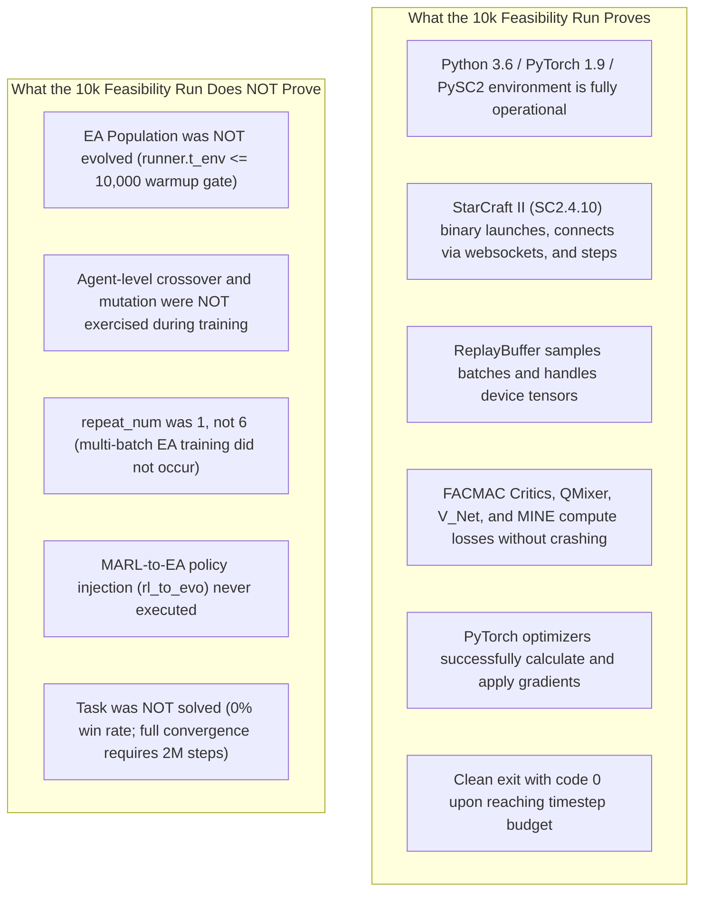

# 07 — Feasibility Run Analysis, Output Artifacts, and Logging

This document provides a forensic, read-only analysis of the minimal reproduction feasibility test executed in `feasibility_results/20261027_165005/`, details the logging mechanisms, and clarifies what the 10,000-step test proves and does not prove.

---

## 1. Feasibility Run Overview

The user executed a 10,000-step smoke test using [`run_race_feasibility.sh`](file:///home/tharuka/Documents/GitHub/RACE/run_race_feasibility.sh). The run produced test artifacts in `feasibility_results/20261027_165005/` and Sacred run records in `results/sacred/6/`.

### Run Metadata
* **Timestamp:** 2026-10-27 16:50:05 UTC+5:30.
* **Duration:** 132 seconds (~2.2 minutes) ([`summary.txt:32`](file:///home/tharuka/Documents/GitHub/RACE/feasibility_results/20261027_165005/summary.txt#L32)).
* **Execution Exit Code:** `0` (`TRAIN_EXIT_CODE = 0`) ([`summary.txt:31`](file:///home/tharuka/Documents/GitHub/RACE/feasibility_results/20261027_165005/summary.txt#L31)).
* **Overall Script Result:** `PASS` (7 of 7 verification checks passed).
* **Environment:** StarCraft II (SC2.4.10, Linux x86_64, Base75689), Protoss scenario `3s_vs_3z`.
* **Hardware:** 12th Gen Intel Core i7-12650H, execution set to CPU (`use_cuda=False`).

---

## 2. Timestep Budget vs. Final Reported Environment Step

A critical question arises when examining the stdout log ([`feasibility_results/20261027_165005/training.log`](file:///home/tharuka/Documents/GitHub/RACE/feasibility_results/20261027_165005/training.log)):

> **Observation:**  
> The last printed log line displays:  
> `[INFO 16:51:52] my_main Recent Stats | t_env: 8143 | Episode: 139`  
> Yet, the process reports `Finished Training` at 16:52:16 and exits cleanly with code 0.  
> Did training fail to reach the configured `t_max = 10000`?

### The Code-Level Explanation
The distinction lies between the **loop termination condition** and the **logging interval**:

1. **Termination Condition ([`src/run.py:284`](file:///home/tharuka/Documents/GitHub/RACE/src/run.py#L284)):**
   ```python
   while runner.t_env <= args.t_max:
   ```
   The while loop continues to execute complete episodes as long as `runner.t_env <= 10000`.
2. **Logging Interval Condition ([`src/run.py:451`](file:///home/tharuka/Documents/GitHub/RACE/src/run.py#L451)):**
   ```python
   if (runner.t_env - last_log_T) >= args.log_interval: # log_interval = 2000
       logger.log_stat("episode", episode, runner.t_env)
       logger.print_recent_stats()
       last_log_T = runner.t_env
   ```
3. **Timeline Between Step 8,143 and Termination:**
   - At episode 139, `runner.t_env` was 8,143. Because $8143 - 6098 = 2045 \ge 2000$, `Recent Stats` was printed, and `last_log_T` became 8,143.
   - Episodes 140 through approximately 170 continued to run. With an average episode length of $\sim 58$ steps, each episode incremented `runner.t_env`.
   - Around episode 172, an episode ended with `runner.t_env` crossing 10,000 (e.g., reaching $\approx 10,015$).
   - At that point, $(10015 - 8143) = 1872 < 2000$. The logging threshold was **not reached**, so no stats block was printed.
   - Control returned to the top of the while loop: `runner.t_env <= 10000` evaluated to `False` ($10015 \le 10000$ is False).
   - The loop exited naturally. The environment closed gracefully:
     ```text
     [INFO 16:52:16] absl Shutdown gracefully.
     [INFO 16:52:16] my_main Finished Training
     ```
   - Python terminated with `os._exit(os.EX_OK)` (`code 0`).

**Conclusion:** The run did not stall or fail prematurely at 8,143 steps. It completed its full 10,000 environment step budget. The final counter value simply did not trigger a concluding log line because `log_interval` is evaluated as a step-difference threshold without a post-loop flush.

---

## 3. Training Metrics Recorded in Sacred `info.json`

The file [`results/sacred/6/info.json`](file:///home/tharuka/Documents/GitHub/RACE/results/sacred/6/info.json) preserves the exact time-series telemetry of the run:

| Metric Name | Timestep $t_{env} = 55$ | $t_{env} = 2045$ | $t_{env} = 4079$ | $t_{env} = 6098$ | $t_{env} = 8143$ | Trend Interpretation |
|:---|:---:|:---:|:---:|:---:|:---:|:---|
| **`return_mean`** | 4.50 | 5.78 | 6.66 | 7.13 | 7.62 | Steady increase in episodic return. |
| **`return_std`** | 0.00 | 1.17 | 1.47 | 1.17 | 1.42 | Non-zero variance across episodes. |
| **`critic_loss`** | — | 0.2248 | 0.0633 | 0.0420 | 0.0375 | Rapid convergence of TD($\lambda$) critic loss. |
| **`critic_grad_norm`** | — | 1.4617 | 1.3508 | 1.0315 | 0.8203 | Healthy gradient magnitudes without explosion. |
| **`td_error_abs`** | — | 0.3864 | 0.1922 | 0.1595 | 0.1496 | Mean absolute Bellman error steadily declining. |
| **`epsilon`** | 0.5000 | 0.4816 | 0.4633 | 0.4451 | 0.4267 | Linear annealing schedule active (towards 0.05). |
| **`dead_enemies_mean`** | 0.00 | 0.00 | 0.47 | 0.67 | 0.81 | Stalkers learned to defeat enemy Zealots. |
| **`battle_won_mean`** | 0.00 | 0.00 | 0.00 | 0.00 | 0.00 | 0% win rate (expected for only 10k steps). |

---

## 4. What the 10,000-Step Feasibility Run Proves vs. Does Not Prove



### Key Takeaway for Researchers
The 10k feasibility test is an **infrastructure verification test**, not an **algorithm verification test**. It confirms that the StarCraft II engine, PyMARL framework, CUDA/CPU device routing, replay buffer, and neural networks operate without errors. However, because [`src/run.py:289`](file:///home/tharuka/Documents/GitHub/RACE/src/run.py#L289) gates all evolutionary routines behind `runner.t_env > args.start_timesteps` (`10000`), the evolutionary components of RACE remained dormant throughout the entire test. Testing the evolutionary engine requires setting `t_max > 10000` (e.g., `t_max = 20000` or lowering `start_timesteps = 1000`).

---

## 5. Directory Structure of Generated Artifacts

```text
feasibility_results/20261027_165005/
├── environment.txt         # OS info, python version, PyTorch version, git commit
├── summary.txt             # High-level test summary, command executed, exit code
└── training.log            # Full captured stdout/stderr stream from StarCraft II and PyMARL

results/sacred/6/
├── config.json             # Exact unified configuration dictionary passed to run.py
├── cout.txt                # Raw console standard output stream
├── info.json               # Timestamped metrics array (return, critic_loss, td_error)
└── run.json                # Hardware host information, start/stop times, execution status
```
