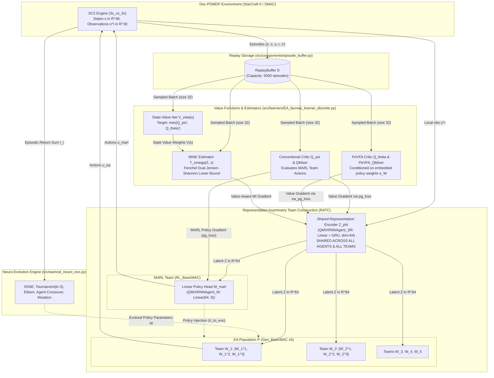
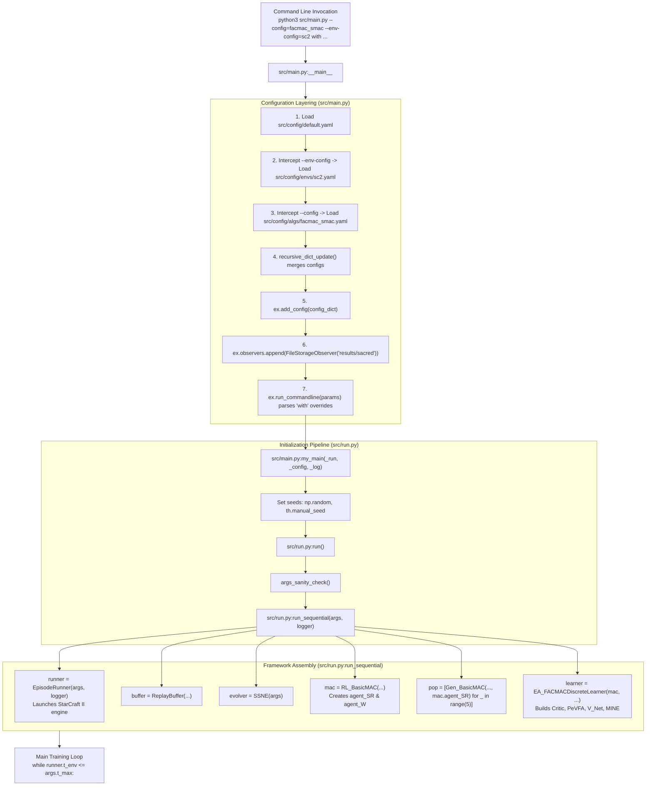
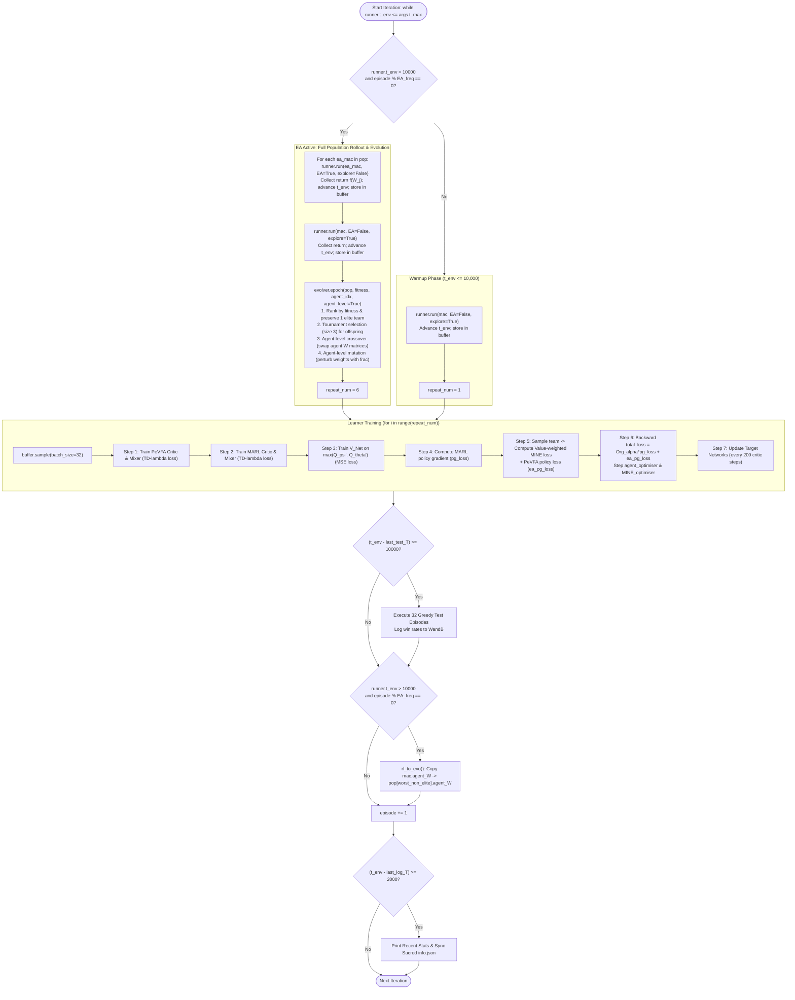
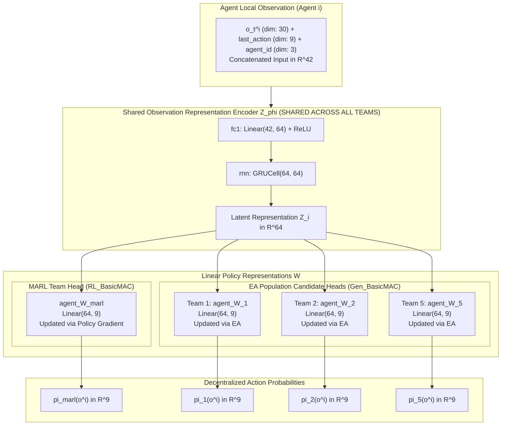
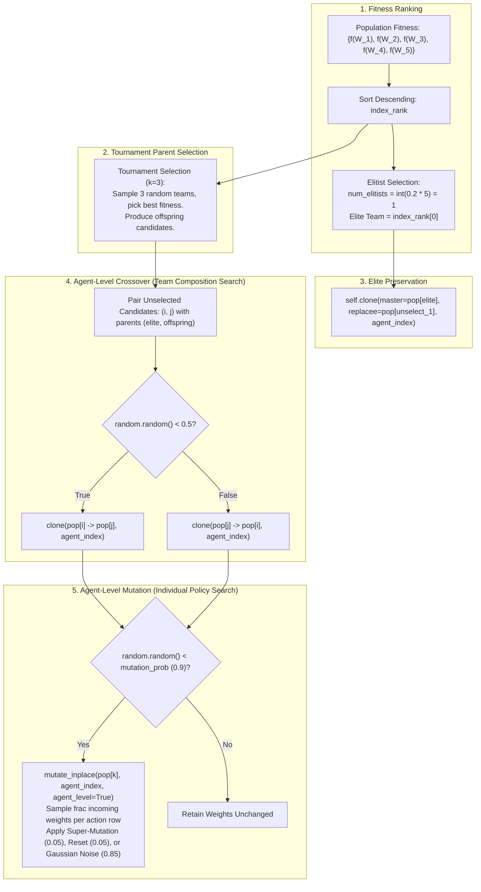
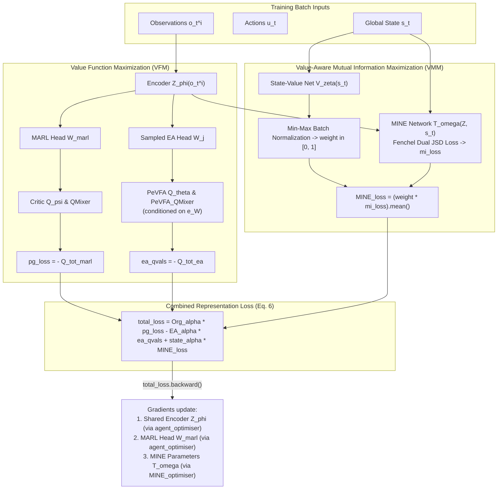
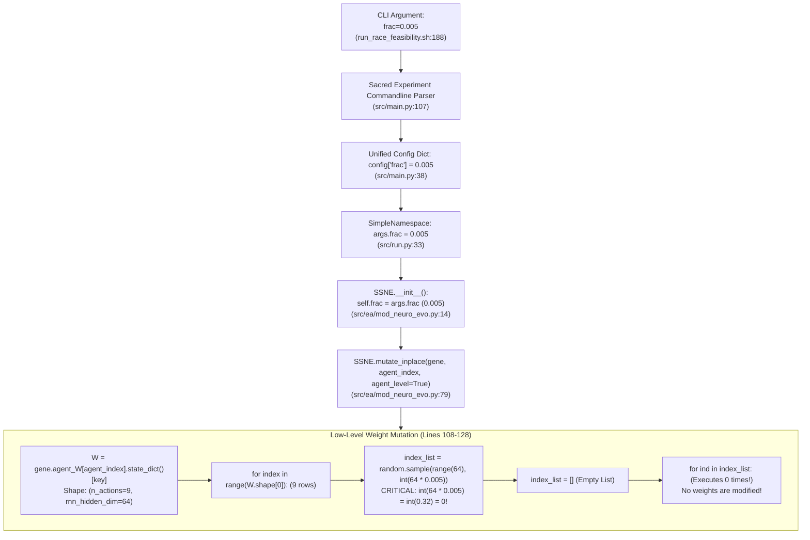
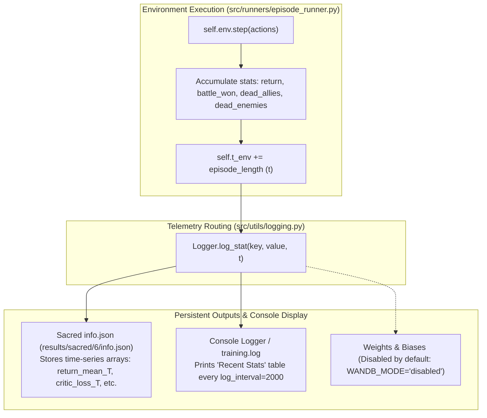

# System Diagrams: Architecture, Dataflows, and Execution Sequences

This document contains eight Mermaid diagrams illustrating the structure, execution sequences, representation mechanics, and parameter traces of the RACE framework as verified directly in the source code.

---

## Diagram A — System Architecture

This diagram shows the complete system architecture: the environment, MARL team, EA population, shared observation representation encoders, replay buffer, critics, PeVFA, and MINE.

**Legend:**
* **Solid Arrows ($\longrightarrow$):** Verified runtime data flow (observations, actions, transition batches, gradients).
* **Dashed Arrows ($-\cdot\to$):** Policy parameter transfer and evolutionary manipulation (cloning, injection, mutation).
* **Supporting Code References:** [`src/controllers/EA_basic_controller.py:7-301`](file:///home/tharuka/Documents/GitHub/RACE/src/controllers/EA_basic_controller.py#L7-L301), [`src/learners/EA_facmac_learner_discrete.py:209-456`](file:///home/tharuka/Documents/GitHub/RACE/src/learners/EA_facmac_learner_discrete.py#L209-L456), [`src/ea/mod_neuro_evo.py:7-208`](file:///home/tharuka/Documents/GitHub/RACE/src/ea/mod_neuro_evo.py#L7-L208).

---

## Diagram B — Startup and Module Call Graph

This diagram shows how execution flows from CLI invocation through Sacred configuration loading to the training loop.

**Supporting Code References:** [`src/main.py:16-107`](file:///home/tharuka/Documents/GitHub/RACE/src/main.py#L16-L107), [`src/run.py:28-284`](file:///home/tharuka/Documents/GitHub/RACE/src/run.py#L28-L284).

---

## Diagram C — One Training Iteration Sequence

This flowchart documents the exact execution sequence observed during a single episodic training iteration.

**Supporting Code References:** [`src/run.py:284-456`](file:///home/tharuka/Documents/GitHub/RACE/src/run.py#L284-L456), [`src/learners/EA_facmac_learner_discrete.py:209-456`](file:///home/tharuka/Documents/GitHub/RACE/src/learners/EA_facmac_learner_discrete.py#L209-L456).

---

## Diagram D — Representation-Asymmetry Team Construction (RATC)

This diagram details the decomposition of agent policies into a shared nonlinear representation encoder and individual linear policy heads.

**Supporting Code References:** [`src/controllers/EA_basic_controller.py:33-58, 174-211`](file:///home/tharuka/Documents/GitHub/RACE/src/controllers/EA_basic_controller.py#L33-L58), [`src/modules/agents/EA_qmix_agent.py:27-68`](file:///home/tharuka/Documents/GitHub/RACE/src/modules/agents/EA_qmix_agent.py#L27-L68).

---

## Diagram E — Evolutionary Operators

This diagram shows parent selection, elitism, agent-level crossover, and mutation inside `SSNE.epoch`.

**Supporting Code References:** [`src/ea/mod_neuro_evo.py:143-207`](file:///home/tharuka/Documents/GitHub/RACE/src/ea/mod_neuro_evo.py#L143-L207).

---

## Diagram F — Shared Representation Learning

This diagram shows how Value Function Maximization (VFM) and Value-Aware Mutual Information Maximization (VMM) integrate to train the shared encoder $Z_\phi$.

**Supporting Code References:** [`src/learners/EA_facmac_learner_discrete.py:327-434`](file:///home/tharuka/Documents/GitHub/RACE/src/learners/EA_facmac_learner_discrete.py#L327-L434).

---

## Diagram G — Parameter Trace for `frac`

This diagram illustrates the path of `frac` from the command-line argument down to row-wise weight sampling.

**Supporting Code References:** [`src/ea/mod_neuro_evo.py:14, 114`](file:///home/tharuka/Documents/GitHub/RACE/src/ea/mod_neuro_evo.py#L14).

---

## Diagram H — Experiment and Telemetry Logging Flow

This diagram shows how metrics flow from episode rollouts through loggers to Sacred files and terminal displays.

**Supporting Code References:** [`src/runners/episode_runner.py:129-160`](file:///home/tharuka/Documents/GitHub/RACE/src/runners/episode_runner.py#L129-L160), [`src/utils/logging.py:27-53`](file:///home/tharuka/Documents/GitHub/RACE/src/utils/logging.py#L27-L53).
